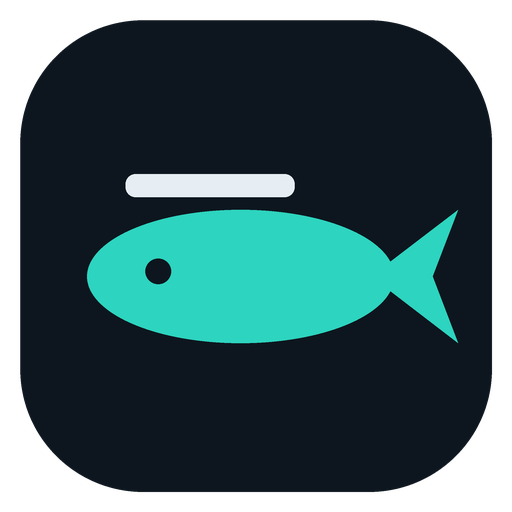
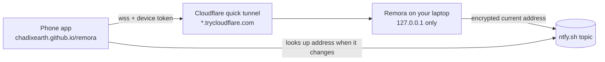

<p align="center"></p>

<h1 align="center">Remora</h1>
<p align="center"><b>Your laptop, in your pocket.</b><br>
Pair your phone once, then see your screen, control it, open a terminal and move files from anywhere.</p>

---

Remora is a desktop app plus a phone app. Leave your laptop on at home, and from your phone you can:

- **Screen**: watch the screen live; tap to click, long-press to right-click, two-finger drag to scroll, and type with your phone keyboard.
- **Terminal**: open a real shell (PowerShell on Windows) on the laptop. Run your coding agents, git and builds.
- **Files**: browse every folder and drive, download to your phone, upload from your phone.
- **Status & actions**: CPU, memory, battery and uptime, plus lock, sleep, open a URL and share the clipboard.

There are no accounts, no port forwarding, no VPN and no admin rights needed.

## Install

1. **On your laptop**: download `Remora-Setup-x.y.z.exe` from [Releases](../../releases/latest) and run it. It installs per-user, so you won't get an admin prompt.
2. In Remora, click **Pair a phone**. A QR code appears.
3. **On your phone**: scan the QR code with the camera and open the link. The laptop is added to the phone app at <https://chadixearth.github.io/remora/>.
4. Add the phone app to your home screen (Share → *Add to Home Screen* on iPhone, ⋮ → *Install app* on Android).
5. Back in Remora on the laptop, switch on what the phone is allowed to do: **Control**, **Terminal**, **Files**.

That's it. From now on, open Remora on your phone from anywhere.

> Remora currently ships for Windows 10/11. The phone app works on any modern iPhone or Android browser.

## How it works



- The desktop app's server listens on `127.0.0.1` only. A [Cloudflare quick tunnel](https://developers.cloudflare.com/cloudflare-one/connections/connect-networks/do-more-with-tunnels/trycloudflare/) (`cloudflared`, downloaded on first run) is the only way in from outside, so no router setup is needed.
- The tunnel address changes whenever the laptop restarts. Remora publishes the current address to a random [ntfy.sh](https://ntfy.sh) topic, **encrypted with AES-256-GCM** using a key that only your paired phones have. ntfy only ever sees an encrypted blob.
- Screen frames are JPEGs with ack-based flow control: the laptop sends the next frame only after the phone has drawn the last one. Slow networks therefore get fewer frames instead of growing lag. You can choose Fast, Balanced or Sharp quality.

## Security

Remora gives a paired phone real power over your laptop, so it is designed to be strict by default.

| Protection | How |
|---|---|
| Pairing needs the laptop in front of you | One-time 128-bit secret in the QR code, valid for 10 minutes, single use. It rotates after 10 wrong guesses |
| Per-device access | Each phone gets its own random 256-bit token. The laptop stores only a SHA-256 hash. Remove a device and it is disconnected immediately |
| Least privilege | **Control**, **Terminal** and **Files** start **off**. Only screen viewing is on by default. Switching one off takes effect instantly, including closing open terminals |
| Audit log | Every pairing, connection, terminal command line, file transfer and action is recorded in the Activity panel |
| No exposed ports | The server binds to `127.0.0.1`. Tokens never appear in URLs (WebSocket auth is the first message, and downloads use an `Authorization` header) |

**Anyone holding a paired, unlocked phone can do what the permissions allow.** Use a phone lock screen, and remove lost devices from Remora on the laptop.

## Good to know

- **The laptop must be on and awake.** Remora keeps it awake while running (Settings → *Keep laptop awake*), but closing the lid may still put it to sleep, depending on your Windows lid setting.
- **Windows admin prompts (UAC) and the lock screen** can't be seen or clicked remotely. This is a Windows security boundary. Remora's own input runs as your user.
- Cloudflare quick tunnels are free and need no account, but they have no uptime guarantee. If one drops, Remora reconnects automatically with a new address, and the phone finds it through the encrypted beacon.

## Develop

```bash
npm install
npm start            # run the desktop app (Electron)
npm run web          # serve the phone app on http://127.0.0.1:5173
REMORA_WEB_URL=http://127.0.0.1:5173/ npm start   # pair against the local phone app
npm run dist         # build Remora-Setup.exe into dist/
```

| Path | What |
|---|---|
| `desktop/main.js` | App lifecycle, window, tray, IPC |
| `desktop/core/` | Server (HTTP + WebSocket), pairing, store/audit log, tunnel, beacon |
| `desktop/platform/` | Input (Windows `SendInput`), terminal (`node-pty`), files, system status, actions |
| `desktop/capture/` | Screen capture in a hidden window → JPEG frames |
| `desktop/ui/` | Desktop interface |
| `web/` | Phone app (static PWA, deployed to GitHub Pages) |

Releases: push a `v*` tag and GitHub Actions builds the Windows installer and attaches it to a release.

## License

MIT
